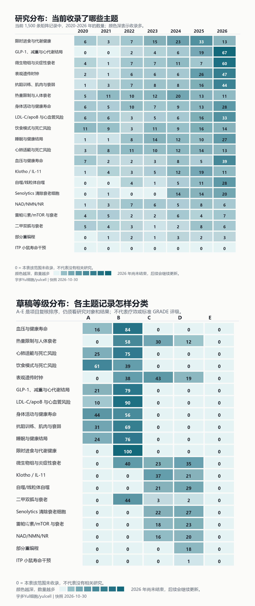
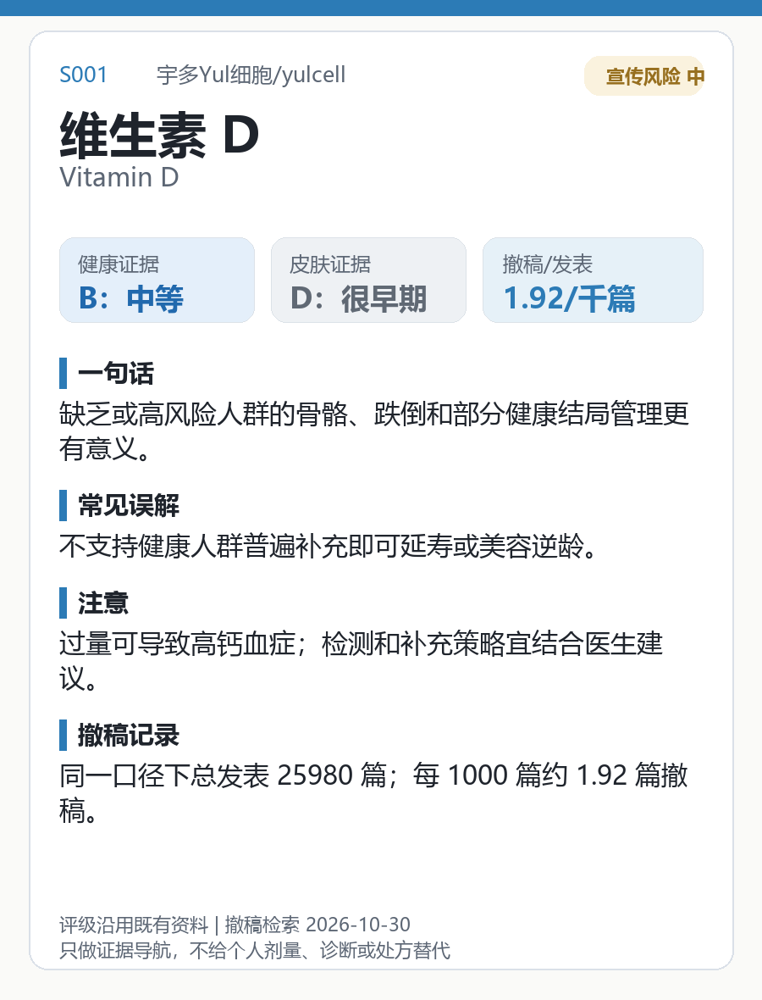
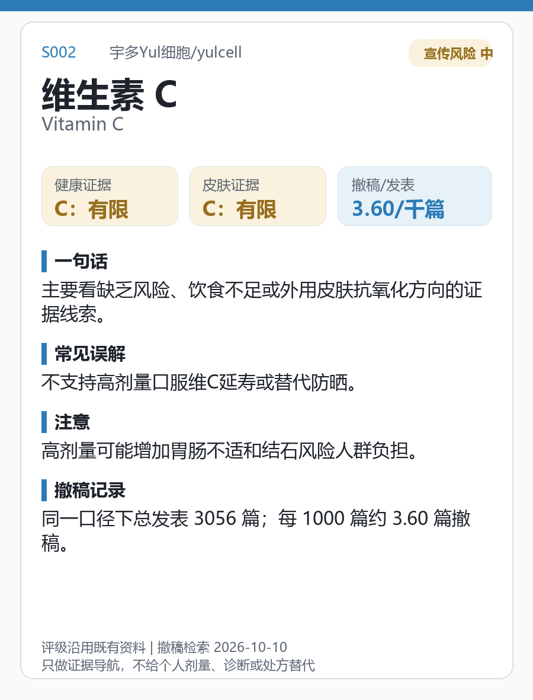

# 宇多Yul细胞/yulcell
## 长寿抗衰与健康寿命证据图谱 / Longevity & Healthspan Evidence Atlas

这里整理运动、睡眠、饮食、补剂和抗衰技术的研究，帮你看清研究了谁、测了什么、结论能支持到哪一步。动物实验、化验指标和人体疾病结局分开呈现。

An evidence guide to exercise, sleep, nutrition, supplements and aging research: who was studied, what was measured, and what the findings support. Animal experiments, biomarkers and human outcomes are kept separate.

资料快照 / Evidence snapshot：2026-10-10 · 分类整理 / Organization：2026-10-16

| 你想做什么 / Your question | 从哪里看 / Open |
| --- | --- |
| 先看图，了解有哪些研究 / See the research | [热力图](#一先看图--visuals) · [成分卡片](content/public-reader/ingredient-cards-top-50.md) |
| 查某个说法有多少支持 / Check a claim | [主题解读](content/public-reader/topics.md) · [补剂速查](content/public-reader/supplements-top-30.md) |
| 找到论文原文 / Trace a source | [文献来源与数据说明](public-data/README.md) |

## 一、先看图 / Visuals

### 研究热力图 / Research Heatmap

看当前收录的研究分布。颜色深表示记录多，不表示效果更好；0 表示当前集合没有记录，不代表没有相关研究。

Counts in the selected matrix, not an efficacy ranking.

[图例与统计范围](content/public-reader/research-heatmap.md) · [飞书看图](https://ucngl3rlrux2.feishu.cn/wiki/WriBw4TXZiOsjQkJWk8ctL1xnVg?table=tblASMHdK01yuvjL)

### 成分卡片 / Ingredient Cards

每张卡分别写健康寿命、皮肤用途、常见误解和注意事项。先看适用场景与限制，再看暂定等级。

Each card distinguishes healthspan and skin contexts and includes limitations.

[查看全部50张卡](content/public-reader/ingredient-cards-top-50.md) · [一张图看50种成分](docs/assets/visual-assets/2026-10/ingredient-card-wall-2026-10.png) · [飞书查成分](https://ucngl3rlrux2.feishu.cn/wiki/WriBw4TXZiOsjQkJWk8ctL1xnVg?table=tbliLsUC2T8lXHla)

## 二、查证据 / Evidence

| 想了解 / Topic | 阅读入口 / Open |
| --- | --- |
| 运动、睡眠、饮食和代谢 | [大众主题速读](content/public-reader/topics.md) |
| NMN、鱼油、胶原蛋白等补剂 | [常见补剂](content/public-reader/supplements-top-30.md) |
| 防晒、皱纹、屏障和医美 | [皮肤与外观](content/public-reader/skin.md) |
| A/B、H1至H6、全文待复核是什么意思 | [读表与缩写说明](content/public-reader/evidence-weight.md) |
| 比较不同研究 | [飞书证据对照表](https://ucngl3rlrux2.feishu.cn/wiki/WriBw4TXZiOsjQkJWk8ctL1xnVg?table=tblLnS2g439w9pir) |

等级是项目草稿排序，研究笔记仍可能等待全文复核。图片制作日期不代表评级重新确认；不能据此自行用药、停药或购买补剂。

Grades and notes are provisional. New images do not imply revalidated evidence. This atlas does not provide personal medical or purchase advice.

## 三、找原文 / Sources

[文献来源目录](https://ucngl3rlrux2.feishu.cn/wiki/WriBw4TXZiOsjQkJWk8ctL1xnVg?table=tblIPdcBJPH6UkAE) · [公开数据与字段说明](public-data/README.md) · [全部当前入口](docs/asset-catalog.md)

五张数据表是不同处理层，同一论文可能重复出现，总行数不是独立论文数。查具体文献时用 PMID 或 DOI。

The five data layers overlap. Use PMID or DOI to trace individual papers.

更新记录、历史资料与维护 / Updates, Archives and Maintenance

- [最近一次文献更新](content/public-reader/october-10-2026-update.md)
- [历史版本统一入口](archive/README.md)
- [维护与分表规则](docs/data-retention-and-curation-policy.md)
- [核验状态](docs/current-output-status.md)
- [中文说明](README.zh-CN.md) · [更新日志](CHANGELOG.md)

GitHub保存版本；飞书用于看图、筛选和复核。HTML报告可下载后离线打开，图片已内嵌，不需要本地网站。

GitHub preserves versions; Feishu supports browsing and review. Downloaded HTML reports work offline without a server.

