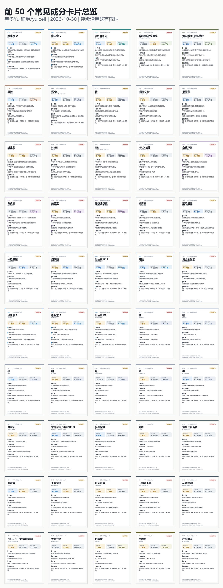

# 宇多Yul细胞/yulcell：2026 年 10 月 23 日文献与资产更新

**冻结日期 / Snapshot date:** 2026-10-23 
**检索窗口 / Search window:** 2026/10/11..2026/10/23 
**本轮整理 / This update:** 补充相关新研究，清理弱相关与错分记录，保留固定容量。

## 这张图谱是什么 / What This Atlas Is

它整理运动、睡眠、饮食、补剂和抗衰研究，帮助你看清：研究了谁，测了什么，结论能用到哪里。热力图看研究分布，成分卡查具体用途，再沿链接核对论文。

This atlas explains who was studied, what was measured and how far the findings apply. Start with the visuals, look up an ingredient, then follow the sources.

本轮检索找到 526 个 PubMed 匹配，筛选后保留 120 条近期候选。当前目录 11,176 条、待复核研究笔记 2,487 条。各主题继续按固定容量更新。

## 先看图，再查成分 / Visuals and Ingredients

颜色表示当前收录的记录数量。颜色深说明记录多，不能当作疗效更强。

[50种成分逐张查](../../../../content/public-reader/ingredient-cards-top-50.md) · [离线图文报告与图片下载](../../docs/october-23-public-update-2026-10.html)

## 近期研究，逐篇看懂 / Recent Studies Explained

以下六篇已核对官方摘要，全文尚待复核。检索采用 PubMed 发表日期，可能包括较早在线发表、最近编入期刊的文章。Each note is based on the official abstract; full-text review is pending.

### 握力变弱，可能早于日常生活变困难

人群追踪研究 / Cohort；B 级草稿。[官方来源 / PubMed 42880160](https://pubmed.ncbi.nlm.nih.gov/42880160/)

研究使用中国健康与养老追踪调查，纳入6,904名50至64岁成人。对起初没有相应生活困难的人，最长追踪9年：握力偏低者后来出现基本日常活动困难的风险较高，风险比为1.42。这里的困难包括日常自理受限，并非只看肌肉大小。握力可以提供筛查线索，但这项观察研究没有检验练握力能否预防这些困难。

The study used CHARLS data from 6,904 adults aged 50-64. Among participants initially free of the relevant impairment, follow-up lasted up to nine years. Low handgrip strength was associated with incident basic activities-of-daily-living impairment (HR 1.42). Grip strength may help identify people needing assessment; this observational study did not test whether grip training prevents disability.

### 力量训练，练出来的改变要看具体测了什么

多项研究汇总 / Review & meta-analysis；B 级草稿。[官方来源 / PubMed 42660338](https://pubmed.ncbi.nlm.nih.gov/42660338/)

这篇综述汇总15项随机试验，共438人，研究离心超负荷训练，也就是着重训练肌肉一边受力、一边被拉长的阶段。合并结果显示，下肢力量和爆发力有所改善。与不训练相比，力量改善较明确；与常规抗阻训练的比较仍需更多研究。它回答的是身体功能问题，没有测量人能否活得更久。

This review pooled 15 randomized trials involving 438 older adults. Eccentric overload training emphasizes the phase in which a muscle lengthens under load. Pooled results favored lower-limb strength and explosive power. Strength gains were clearer against inactive controls; superiority over conventional resistance training remains uncertain. The outcomes were physical function, not lifespan.

### 体重下降时，力气能不能保住？

多项研究汇总 / Review & meta-analysis；C 级草稿。[官方来源 / PubMed 42897109](https://pubmed.ncbi.nlm.nih.gov/42897109/)

综述中的主要合并分析纳入10项研究、660名使用司美格鲁肽的人，比较用药前后的握力。平均变化为-0.16公斤力，统计区间跨过零，研究之间差异很大。关键是这些合并比较没有对照组，作者把证据确定性评为很低。因此，暂时没看出明确变化，也不能说明药物已经被证实能保住肌力；药物选择仍需结合个人病情由医生评估。

The primary meta-analysis pooled uncontrolled before-after changes from ten studies with 660 semaglutide-treated participants. Mean grip-strength change was -0.16 kgf, with a confidence interval crossing zero and substantial heterogeneity. The authors rated certainty very low. A nonsignificant change does not establish preserved strength or a causal drug effect. Treatment decisions require an individualized clinical assessment.

### 换了饮食，炎症指标为什么没马上下降？

临床试验 / Clinical trial；C 级草稿。[官方来源 / PubMed 42906553](https://pubmed.ncbi.nlm.nih.gov/42906553/)

53名有代谢风险的成人参加16周试验。前8周分别采用研究提供的地中海饮食或原有西式饮食，主要炎症指标超敏C反应蛋白没有改变。后8周加入间歇性禁食后，地中海饮食组相对对照组的该指标下降，同时体重也降得更多。饮食、禁食和体重变化交织在一起，不能把结果归功于某一种食物；短期炎症指标也不能替代长期疾病结局。

In a 16-week trial, 53 adults with metabolic risk factors received a Mediterranean or habitual Western diet. The primary inflammatory marker, high-sensitivity C-reactive protein, did not change during the first eight diet-only weeks. After intermittent fasting was added, it fell in the Mediterranean-diet group relative to controls, alongside greater weight loss. These intertwined changes do not isolate one food or establish long-term disease benefits.

### 高龄照护中的减药，为什么没有一个统一答案？

多项研究汇总 / Review & meta-analysis；B 级草稿。[官方来源 / PubMed 42888381](https://pubmed.ncbi.nlm.nih.gov/42888381/)

综述纳入3项随机研究，涉及1,548名长期照护机构住民。不同试验的人群、减药办法、监测和随访差异很大，作者没有把它们强行合成一个效果数字。减药确实减少了用药数量，也使血压上升；对死亡、住院等结局，目前还无法给出统一判断。这里研究的是医生监测下的减药，普通读者不应据此自行停药。

Three randomized studies included 1,548 long-term care residents. Populations, deprescribing strategies, monitoring and follow-up differed enough that the authors did not pool them into one effect estimate. Supervised deprescribing reduced medication exposure and raised blood pressure; a common effect on mortality or hospitalization remains unestablished. The findings concern monitored clinical care, not stopping medication independently.

### 15人的血液分析，离“抗衰有效”还有多远？

探索性资料，研究类型待复核 / Design pending review；E 级草稿。[官方来源 / PubMed 42900294](https://pubmed.ncbi.nlm.nih.gov/42900294/)

这是一项随机试验里的探索性血液子研究，共15名55岁以上、没有糖尿病的老年黄斑变性患者，其中8人接受二甲双胍、7人为对照。研究测量的是基因表达。把多次比较造成的偶然差异考虑进去后，没有单个基因达到统计显著；一些通路分析出现了值得继续研究的信号。样本很小，也没有由这些血液结果证明人变年轻或寿命延长。

This exploratory blood substudy included 15 nondiabetic adults aged at least 55 with age-related macular degeneration: eight receiving metformin and seven controls. No individual gene differed significantly after correction for multiple comparisons. Pathway analyses produced hypothesis-generating signals requiring replication. The small molecular study did not establish rejuvenation or lifespan extension.

资料数量、筛选规则与校验记录 / Counts, Curation and Checks

## 本期资料变化 / What Changed

This release adds and retires records within fixed capacity limits. Counts may rise or fall; older versions remain recoverable.

| 层级 / Layer | 上期 / Before | 旧记录退出 / Retired | 新进入 / Added | 当前 / After | 净变化 / Net |
| --- | --- | --- | --- | --- | --- |
| 候选 / Candidates | 11,167 | 99 | 108 | 11,176 | +9 |
| 发现 / Findings | 2,450 | 20 | 57 | 2,487 | +37 |

按上期与本期记录 ID 比较；“新进入”可能来自原有候选，不等于本期新发表。Actual turnover compares stable record identifiers, not first-publication dates.

## 先看懂四个数字 / Four Numbers to Understand First

| 数字 | 是什么 | 不是什么 |
| ---: | --- | --- |
| 11,176 | 当前候选文献目录 | 不是 11,176 个已证实结论 |
| 2,487 | 与主题直接相关、进入复核层的 findings | 不是全部完成全文人工复核 |
| 1,500 | 公开证据矩阵行数 | 不是论文总数 |
| 28,826 | 五张公开 CSV 的处理层行数总和 | 同一论文可跨层出现，不能当成独立论文数 |

## 本轮找到了什么 / What the Search Found

- 20 个固定主题，各运行一条有限窗口查询。
- PubMed 唯一匹配：526 条。
- 新候选：513 条；已在库中：13 条。
- 最终保留近期候选：120 条；其中进入 findings：63 条。
- 新记录仍是自动整理草稿，不能因为标成 A 或 B 就直接改成医学结论。
- 检索按 PubMed 发表日期筛选，可能包含较早在线发表、最近编入期刊的文章；不等于这些论文都是本周首次公开。

## 为什么要删 / Why Active Records Were Retired

历史视觉归档收纳 300 个旧网页和图片原件，原始体积约 189.1 MiB。每个文件都校验 SHA-256；当前与上一期入口继续保留，旧网页改为归档提示。这整理的是公开工作目录，不代表 Git 全部历史的下载体积变小。 / Verified archives preserve 300 original historical files. Current and previous releases remain accessible; this tidies the working tree, not the size of the complete Git history.

| 层级 | 退出原因 | 决定数 |
| --- | --- | --- |
| 候选层 | 题名显示不是结果论文 | 4 |
| 候选层 | 超过主题容量，保留优先级更高者 | 500 |
| findings | 题名显示不是结果论文 | 4 |
| findings | 人体主题中的动物或细胞记录 | 11 |
| findings | 方案论文或注册计划 | 4 |
| findings | 题名与分配主题没有直接关系 | 286 |
| findings | 超过主题容量，保留优先级更高者 | 90 |
| findings | 虽命中关键词，但不属于本主题的长寿或健康寿命范围 | 88 |

“退出”只表示不再占用当前公开层的位置，不代表论文被否定。决定数包含新抓取后未通过筛选的材料，不全是旧记录被移除。每条决定都保留在 `data/archive/`，旧完整快照可从 ZIP 和 Git 历史恢复。

## 容量规则 / Capacity Rules

- 候选层：每个主题最多 600 条。
- findings：每个主题最多 200 条，不为填满而凑数。
- 证据矩阵：总计最多 1,500 条，每主题最多 100 条。
- 核心人工复核队列：每主题最多 3 条，本版共 54 条。
- 每周自动检索只能生成有上限的 intake Pull Request，不能再直接把候选推入 `main`。

完整规则：[精编与归档规则](../../../../docs/data-retention-and-curation-policy.md)

## 当前等级分布 / Current Draft Grades

| A | B | C | D | E |
| ---: | ---: | ---: | ---: | ---: |
| 231 | 1,330 | 430 | 437 | 59 |

等级是排序工具，不是处方。A 表示更值得优先复核，不代表“人人应该用”。

## 20 个主题的当前体量 / Active Size by Topic

| 主题 | Topic | 候选 | findings |
| --- | --- | --- | --- |
| 自噬/线粒体自噬 | Autophagy and Mitophagy | 600 | 82 |
| 血压与健康寿命 | Blood Pressure and Healthspan | 600 | 200 |
| 热量限制与人体衰老 | Caloric Restriction in Humans | 600 | 103 |
| 心肺适能与死亡风险 | Cardiorespiratory Fitness and Mortality | 600 | 148 |
| 饮食模式与死亡风险 | Dietary Patterns and Mortality | 600 | 200 |
| 表观遗传时钟 | Epigenetic Clocks | 600 | 131 |
| GLP-1、减重与心代谢结局 | GLP-1, Weight Loss, and Cardiometabolic Outcomes | 600 | 200 |
| ITP 小鼠寿命干预 | ITP Mouse Lifespan Interventions | 179 | 11 |
| Klotho / IL-11 | Klotho / IL-11 | 600 | 77 |
| LDL-C/apoB 与心血管风险 | LDL-C/apoB and Cardiovascular Risk | 600 | 200 |
| 二甲双胍与衰老 | Metformin and Aging | 600 | 49 |
| 微生物组与炎症性衰老 | Microbiome and Inflammaging | 600 | 105 |
| NAD/NMN/NR | NAD/NMN/NR | 554 | 38 |
| 部分重编程 | Partial Reprogramming | 324 | 31 |
| 身体活动与健康寿命 | Physical Activity and Healthspan | 600 | 200 |
| 雷帕霉素/mTOR 与衰老 | Rapamycin/mTOR and Aging | 519 | 56 |
| 抗阻训练、肌肉与衰弱 | Resistance Training, Muscle, and Frailty | 600 | 200 |
| Senolytics 清除衰老细胞 | Senolytics | 600 | 56 |
| 睡眠与健康结局 | Sleep and Aging Outcomes | 600 | 200 |
| 限时进食与代谢健康 | Time-Restricted Eating and Metabolic Health | 600 | 200 |

## 本轮修正的质量问题 / Quality Fixes

- PubMed XML 解析继续限制在论文本身的 ArticleIdList，参考文献 DOI/PMCID 不会覆盖主文献标识。
- 用 NCBI 官方 E-utilities 核对全部 2,487 个 findings PMID：缺失 0，实质题名冲突 0。
- 本轮修正 findings DOI 0 个、PMCID 12 个；候选 DOI 0 个、PMCID 24 个。
- 方案论文、评论勘误、明确动物实验不再被自动抬进人体高等级层。
- 模型推算的安慰剂比较、试验中的观察性二次分析，不沿用母试验的随机对照身份；本版按更保守的独立类型标注，最高 C 级，仍待全文复核。
- 明确写作准实验、或对照组非随机分配的研究，独立标为非随机/混合分配研究，最高 C 级；不能因为一部分组间随机化，就把所有比较当作随机对照。 / Quasi-experimental and mixed-allocation studies are not fully randomized comparisons.
- 额外排除塑料老化等环境研究，以及没有老龄语境的青少年竞技训练；病例资料汇总最高按 C 级，主题等级不能放宽动物研究的 D 级上限。
- 50 张成分卡的评级沿用既有资料，本轮刷新撤稿检索、来源链接和图片；不表示 50 个成分都完成了新的全文复核。 / Ingredient grades remain provisional; refreshed counts and visuals do not imply a new full-text review of every ingredient.

本轮补查发现的分类问题：塑料老化、鱼类年龄预测退出当前研究笔记，原始候选仍保留；引用队列研究的叙述性综述单独标注；无对照的组内变化汇总最高 C 级；全血基因表达归入生物标志物层。These are draft classification corrections, not a new full-text assessment of all records.

## 图片与公开资产 / Visuals and Public Assets

撤稿风险最近查询于 2026-10-23，覆盖 117 个成分/主题，得到 598 条主题匹配记录、去重 542 个 PMID。这是自 2006 年起的发表日期窗口累计，不是本月新增撤稿；撤稿密度不能单独证明成分有效或无效。 / Retraction queries checked 2026-10-23: 117 targets, 598 matched rows, 542 unique PMIDs. Historical cumulative counts are not new monthly retractions or efficacy scores.

- [自包含图文报告 / Self-contained report](../../docs/october-23-public-update-2026-10.html)
- [当前、上一期与历史归档 / Asset catalog](../../../../docs/asset-catalog.md)
- [2026-10 研究图片 / 2026-10 images](../../../../docs/assets/visual-assets/2026-10)
- [飞书 9 张长期表 / Nine stable Feishu tables](../../../../docs/feishu-public-assets-2026-10.md)
- [公开 CSV / Public CSV package](../../../../public-data/README.md)
- [精编与归档规则 / Curation policy](../../../../docs/data-retention-and-curation-policy.md)

## 读者边界 / Reader Boundary

这张图谱用来帮助读者区分证据强弱，不提供个人诊断、处方、剂量、停药建议、医美操作或购买推荐。动物延寿不能写成人类延寿已经证实，指标改善不能写成返老还童，研究数量多也不能写成疗效更强。
