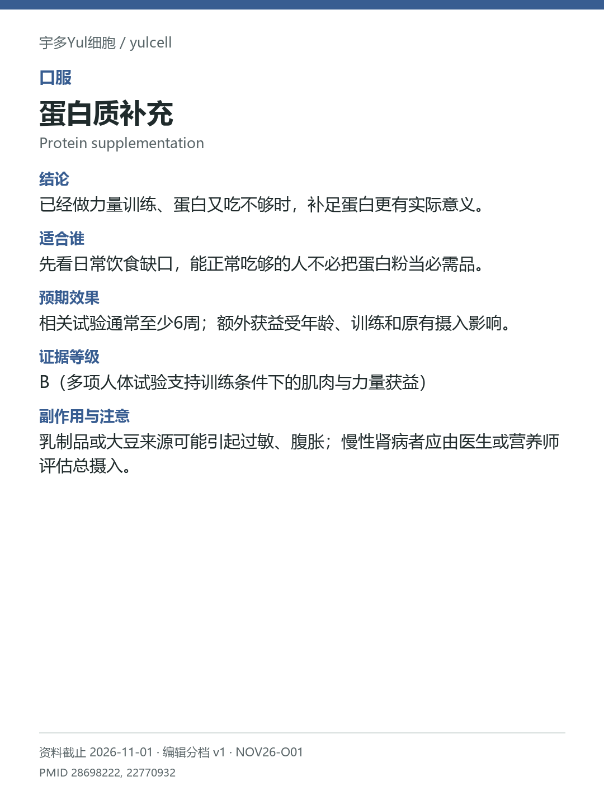

# 蛋白质补充 / Protein supplementation

途径：口服；用途：肌肉与力量；资料截止：2026-11-01。

## 结论
已经做力量训练、蛋白又吃不够时，补足蛋白更有实际意义。

## 适合谁
先看日常饮食缺口，能正常吃够的人不必把蛋白粉当必需品。

## 预期效果
相关试验通常至少6周；额外获益受年龄、训练和原有摄入影响。

## 证据等级
B（多项人体试验支持训练条件下的肌肉与力量获益）

分档版本：ingredient-cards-editorial-v1；[规则](../../../methodology/ingredient-card-grading-v1.md)。

## 副作用与注意
乳制品或大豆来源可能引起过敏、腹胀；慢性肾病者应由医生或营养师评估总摄入。

## 研究范围
饮食不足时的口服蛋白补充。人群：做力量训练、蛋白摄入不足的成人及老年人。不把所有老年人视为蛋白缺乏；身体组成和力量分别看。

## 来源
- [PMID 28698222](https://pubmed.ncbi.nlm.nih.gov/28698222/)
- [PMID 22770932](https://pubmed.ncbi.nlm.nih.gov/22770932/)

- [安全资料](https://www.niddk.nih.gov/health-information/kidney-disease/chronic-kidney-disease-ckd/healthy-eating-adults-chronic-kidney-disease)
