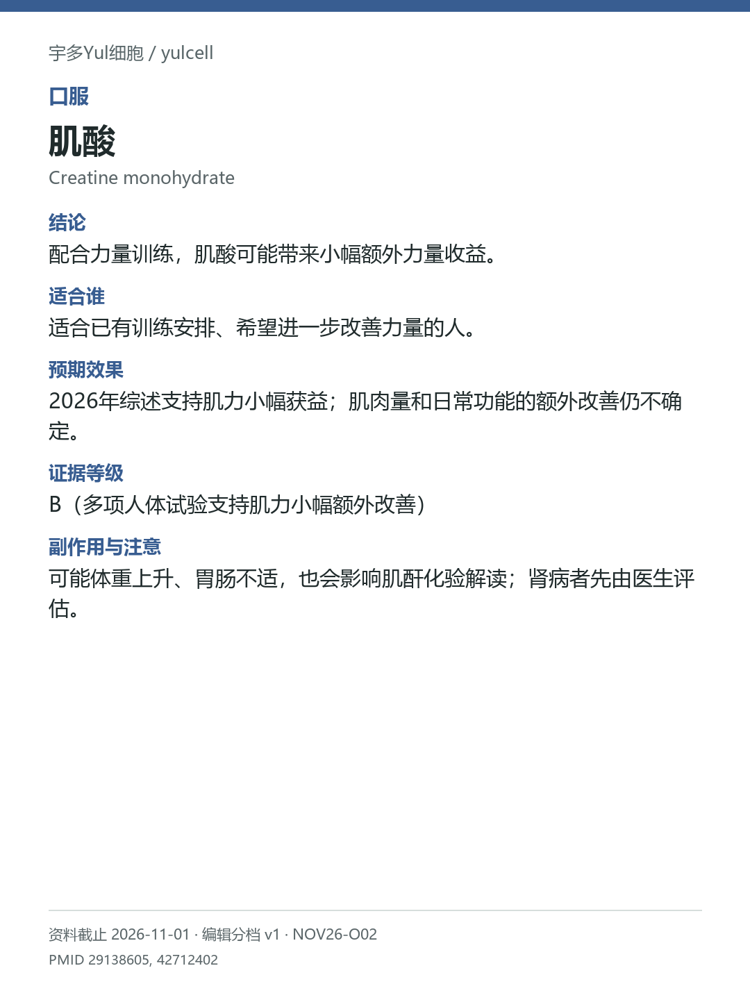

# 肌酸 / Creatine monohydrate

途径：口服；用途：肌力、身体组成；资料截止：2026-11-01。

## 结论
配合力量训练，肌酸可能带来小幅额外力量收益。

## 适合谁
适合已有训练安排、希望进一步改善力量的人。

## 预期效果
2026年综述支持肌力小幅获益；肌肉量和日常功能的额外改善仍不确定。

## 证据等级
B（多项人体试验支持肌力小幅额外改善）

分档版本：ingredient-cards-editorial-v1；[规则](../../../methodology/ingredient-card-grading-v1.md)。

## 副作用与注意
可能体重上升、胃肠不适，也会影响肌酐化验解读；肾病者先由医生评估。

## 研究范围
一水肌酸；与抗阻训练配合的研究为主。人群：能够进行抗阻训练的中老年成人。不把新认知/血液探索性终点替代预设肌力终点；新旧综述不双计。

## 来源
- [PMID 29138605](https://pubmed.ncbi.nlm.nih.gov/29138605/)
- [PMID 42712402](https://pubmed.ncbi.nlm.nih.gov/42712402/)

