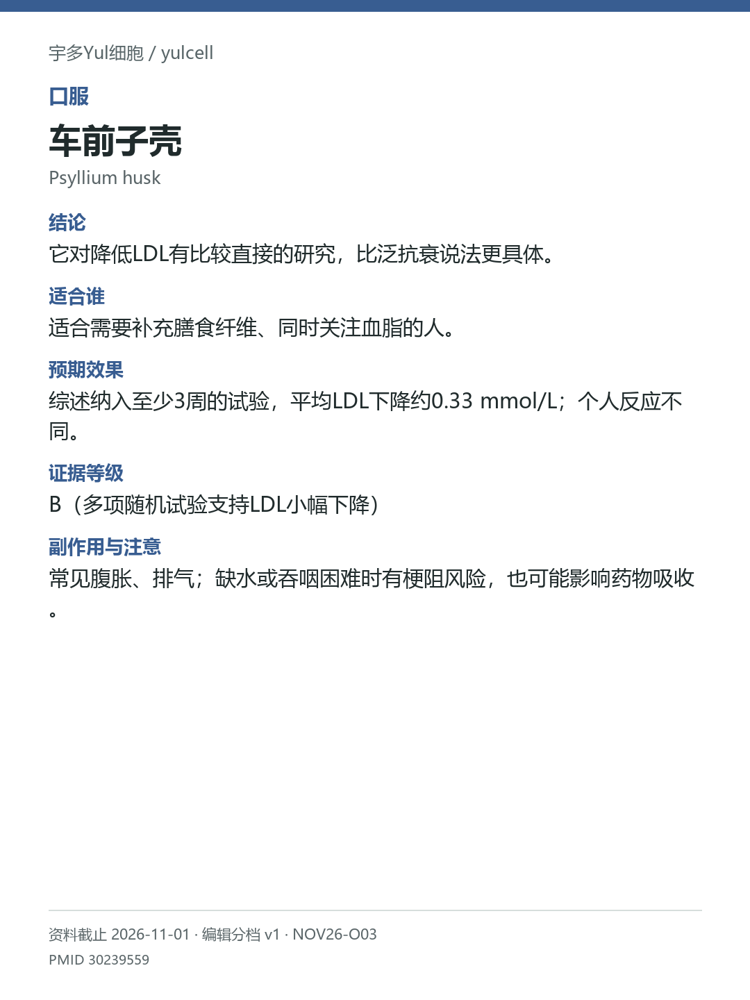

# 车前子壳 / Psyllium husk

途径：口服；用途：LDL胆固醇；资料截止：2026-11-01。

## 结论
它对降低LDL有比较直接的研究，比泛抗衰说法更具体。

## 适合谁
适合需要补充膳食纤维、同时关注血脂的人。

## 预期效果
综述纳入至少3周的试验，平均LDL下降约0.33 mmol/L；个人反应不同。

## 证据等级
B（多项随机试验支持LDL小幅下降）

分档版本：ingredient-cards-editorial-v1；[规则](../../../methodology/ingredient-card-grading-v1.md)。

## 副作用与注意
常见腹胀、排气；缺水或吞咽困难时有梗阻风险，也可能影响药物吸收。

## 研究范围
车前子壳可溶性黏性纤维。人群：LDL偏高或膳食纤维不足的成人。指标变化不是直接测得的心血管事件获益；安全饮水要求属于必要风险信息。

## 来源
- [PMID 30239559](https://pubmed.ncbi.nlm.nih.gov/30239559/)

- [安全资料](https://www.healthhub.sg/medication-devices-and-treatment/medications/ispaghula-husk)
