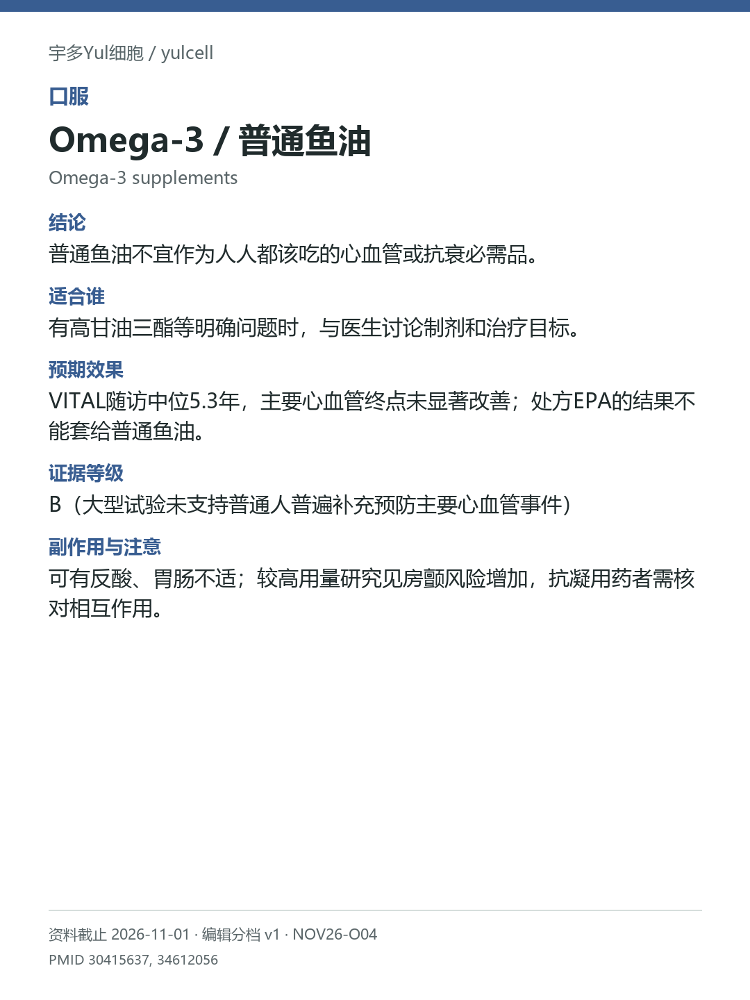

# Omega-3／普通鱼油 / Omega-3 supplements

途径：口服；用途：心血管事件、甘油三酯；资料截止：2026-11-01。

## 结论
普通鱼油不宜作为人人都该吃的心血管或抗衰必需品。

## 适合谁
有高甘油三酯等明确问题时，与医生讨论制剂和治疗目标。

## 预期效果
VITAL随访中位5.3年，主要心血管终点未显著改善；处方EPA的结果不能套给普通鱼油。

## 证据等级
B（大型试验未支持普通人普遍补充预防主要心血管事件）

分档版本：ingredient-cards-editorial-v1；[规则](../../../methodology/ingredient-card-grading-v1.md)。

## 副作用与注意
可有反酸、胃肠不适；较高用量研究见房颤风险增加，抗凝用药者需核对相互作用。

## 研究范围
普通EPA/DHA补充剂；处方高纯EPA另算。人群：一般成人的一次预防与特定血脂问题需分开。B描述研究支持度，不代表建议人人服用；不把不同处方和剂量混为一类。

## 来源
- [PMID 30415637](https://pubmed.ncbi.nlm.nih.gov/30415637/)
- [PMID 34612056](https://pubmed.ncbi.nlm.nih.gov/34612056/)

