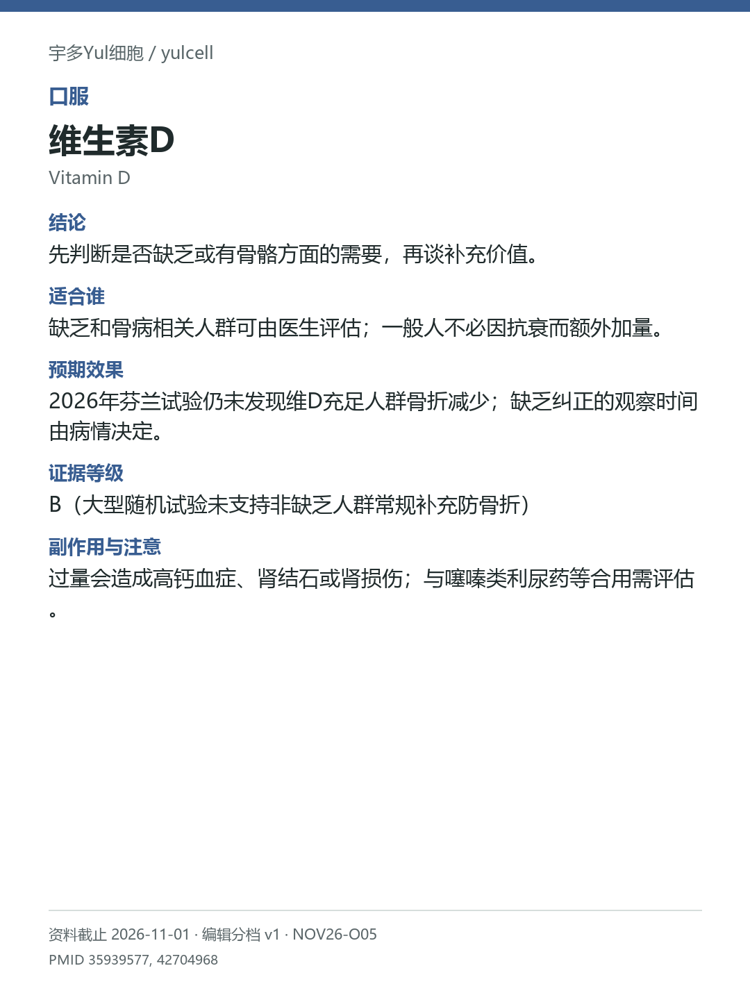

# 维生素D / Vitamin D

途径：口服；用途：骨骼、骨折；资料截止：2026-11-01。

## 结论
先判断是否缺乏或有骨骼方面的需要，再谈补充价值。

## 适合谁
缺乏和骨病相关人群可由医生评估；一般人不必因抗衰而额外加量。

## 预期效果
2026年芬兰试验仍未发现维D充足人群骨折减少；缺乏纠正的观察时间由病情决定。

## 证据等级
B（大型随机试验未支持非缺乏人群常规补充防骨折）

分档版本：ingredient-cards-editorial-v1；[规则](../../../methodology/ingredient-card-grading-v1.md)。

## 副作用与注意
过量会造成高钙血症、肾结石或肾损伤；与噻嗪类利尿药等合用需评估。

## 研究范围
口服维D；缺乏纠正与一般人预防分开。人群：缺乏或有明确骨骼适应证者；非缺乏者单独看。不以营养必需性自动推导额外补充获益；VITAL与芬兰试验不同队列。

## 来源
- [PMID 35939577](https://pubmed.ncbi.nlm.nih.gov/35939577/)
- [PMID 42704968](https://pubmed.ncbi.nlm.nih.gov/42704968/)

- [安全资料](https://ods.od.nih.gov/factsheets/VitaminD-HealthProfessional/)
