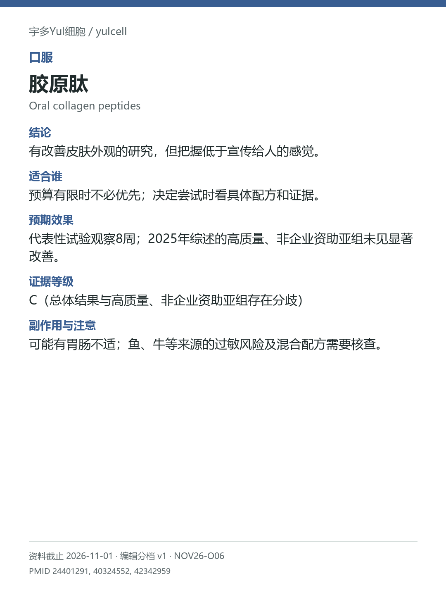

# 胶原肽 / Oral collagen peptides

途径：口服；用途：皮肤水分、弹性、皱纹；资料截止：2026-11-01。

## 结论
有改善皮肤外观的研究，但把握低于宣传给人的感觉。

## 适合谁
预算有限时不必优先；决定尝试时看具体配方和证据。

## 预期效果
代表性试验观察8周；2025年综述的高质量、非企业资助亚组未见显著改善。

## 证据等级
C（总体结果与高质量、非企业资助亚组存在分歧）

分档版本：ingredient-cards-editorial-v1；[规则](../../../methodology/ingredient-card-grading-v1.md)。

## 副作用与注意
可能有胃肠不适；鱼、牛等来源的过敏风险及混合配方需要核查。

## 研究范围
口服水解胶原肽；来源及配方有差别。人群：关注皮肤外观的成人。2026综述总体阳性不消除质量/资助分歧；亚组不显著不等于效果精确为零。

## 来源
- [PMID 24401291](https://pubmed.ncbi.nlm.nih.gov/24401291/)
- [PMID 40324552](https://pubmed.ncbi.nlm.nih.gov/40324552/)
- [PMID 42342959](https://pubmed.ncbi.nlm.nih.gov/42342959/)

