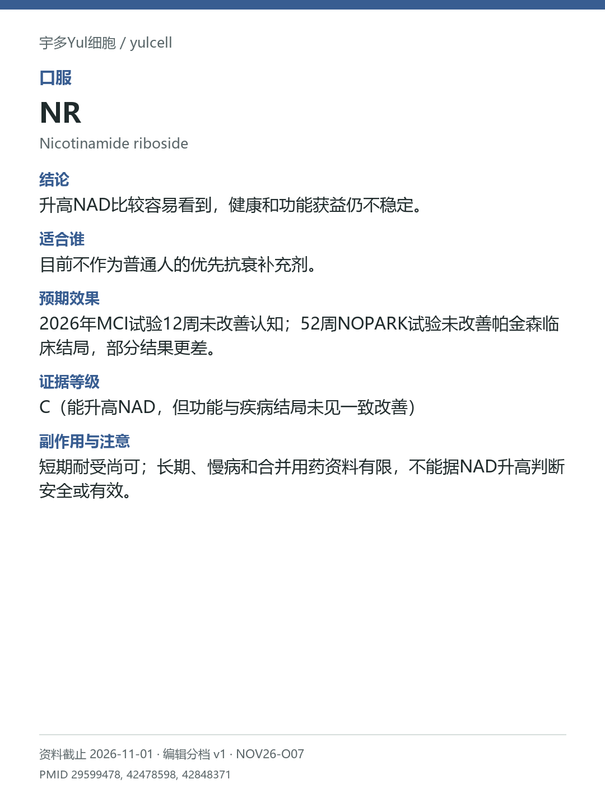

# NR / Nicotinamide riboside

途径：口服；用途：NAD代谢物、认知与疾病功能；资料截止：2026-11-01。

## 结论
升高NAD比较容易看到，健康和功能获益仍不稳定。

## 适合谁
目前不作为普通人的优先抗衰补充剂。

## 预期效果
2026年MCI试验12周未改善认知；52周NOPARK试验未改善帕金森临床结局，部分结果更差。

## 证据等级
C（能升高NAD，但功能与疾病结局未见一致改善）

分档版本：ingredient-cards-editorial-v1；[规则](../../../methodology/ingredient-card-grading-v1.md)。

## 副作用与注意
短期耐受尚可；长期、慢病和合并用药资料有限，不能据NAD升高判断安全或有效。

## 研究范围
口服烟酰胺核糖；与NMN分开。人群：健康中老年研究与帕金森/MCI人群分别看。疾病人群阴性不等于健康人同样受害，也不等于无人体研究。

## 来源
- [PMID 29599478](https://pubmed.ncbi.nlm.nih.gov/29599478/)
- [PMID 42478598](https://pubmed.ncbi.nlm.nih.gov/42478598/)
- [PMID 42848371](https://pubmed.ncbi.nlm.nih.gov/42848371/)

