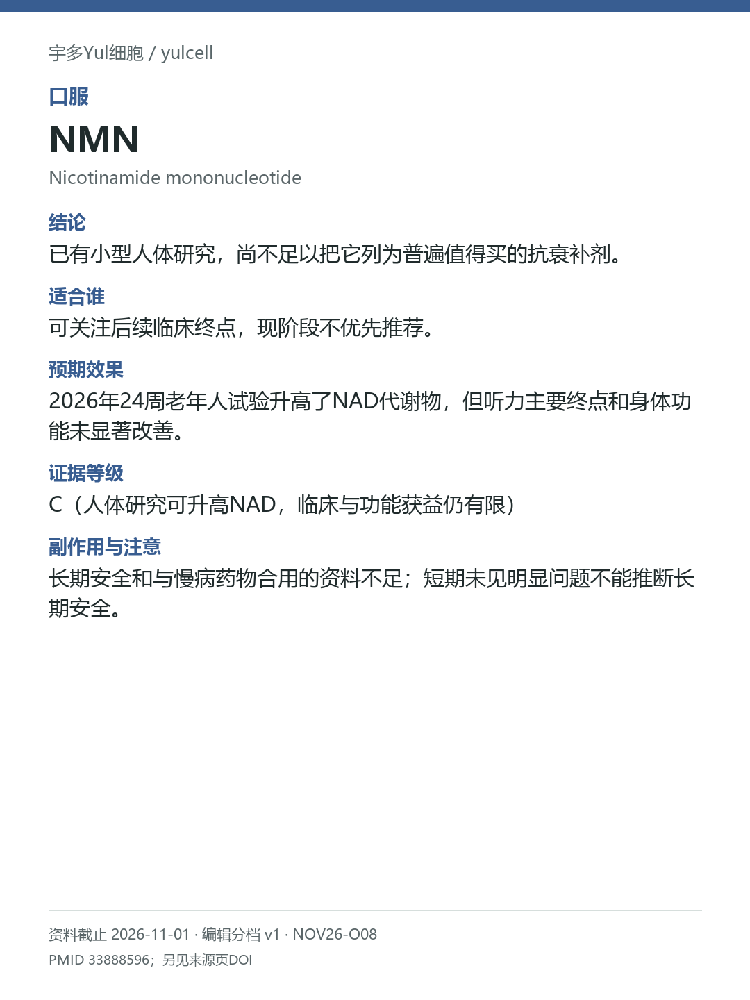

# NMN / Nicotinamide mononucleotide

途径：口服；用途：代谢指标、身体功能；资料截止：2026-11-01。

## 结论
已有小型人体研究，尚不足以把它列为普遍值得买的抗衰补剂。

## 适合谁
可关注后续临床终点，现阶段不优先推荐。

## 预期效果
2026年24周老年人试验升高了NAD代谢物，但听力主要终点和身体功能未显著改善。

## 证据等级
C（人体研究可升高NAD，临床与功能获益仍有限）

分档版本：ingredient-cards-editorial-v1；[规则](../../../methodology/ingredient-card-grading-v1.md)。

## 副作用与注意
长期安全和与慢病药物合用的资料不足；短期未见明显问题不能推断长期安全。

## 研究范围
口服NMN；与NR、静脉NAD分开。人群：前糖尿病女性与其他中老年人群分别看。旧前糖尿病女性研究仅支持限定代谢信号；24周研究按出版社向Crossref提交的摘要核对，未阅读全文，不与NR混用。

## 来源
- [PMID 33888596](https://pubmed.ncbi.nlm.nih.gov/33888596/)
- [DOI 10.1038/s41514-026-00482-7](https://doi.org/10.1038/s41514-026-00482-7)

