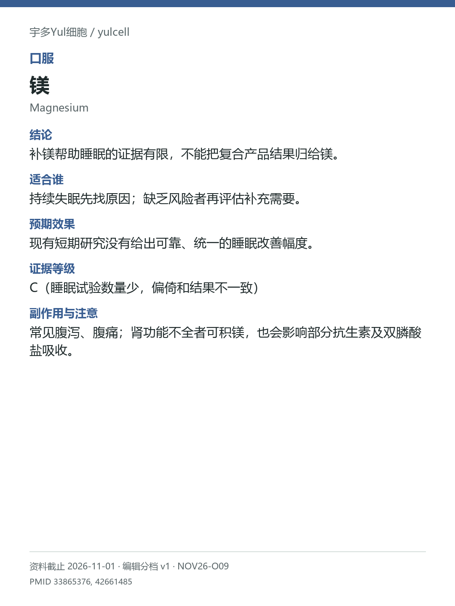

# 镁 / Magnesium

途径：口服；用途：睡眠；资料截止：2026-11-01。

## 结论
补镁帮助睡眠的证据有限，不能把复合产品结果归给镁。

## 适合谁
持续失眠先找原因；缺乏风险者再评估补充需要。

## 预期效果
现有短期研究没有给出可靠、统一的睡眠改善幅度。

## 证据等级
C（睡眠试验数量少，偏倚和结果不一致）

分档版本：ingredient-cards-editorial-v1；[规则](../../../methodology/ingredient-card-grading-v1.md)。

## 副作用与注意
常见腹泻、腹痛；肾功能不全者可积镁，也会影响部分抗生素及双膦酸盐吸收。

## 研究范围
单一口服镁盐；复合助眠产品另算。人群：失眠或可能摄入不足的成人。不从多成分产品试验推出镁单方有效。

## 来源
- [PMID 33865376](https://pubmed.ncbi.nlm.nih.gov/33865376/)
- [PMID 42661485](https://pubmed.ncbi.nlm.nih.gov/42661485/)

- [安全资料](https://ods.od.nih.gov/factsheets/Magnesium-HealthProfessional/)
