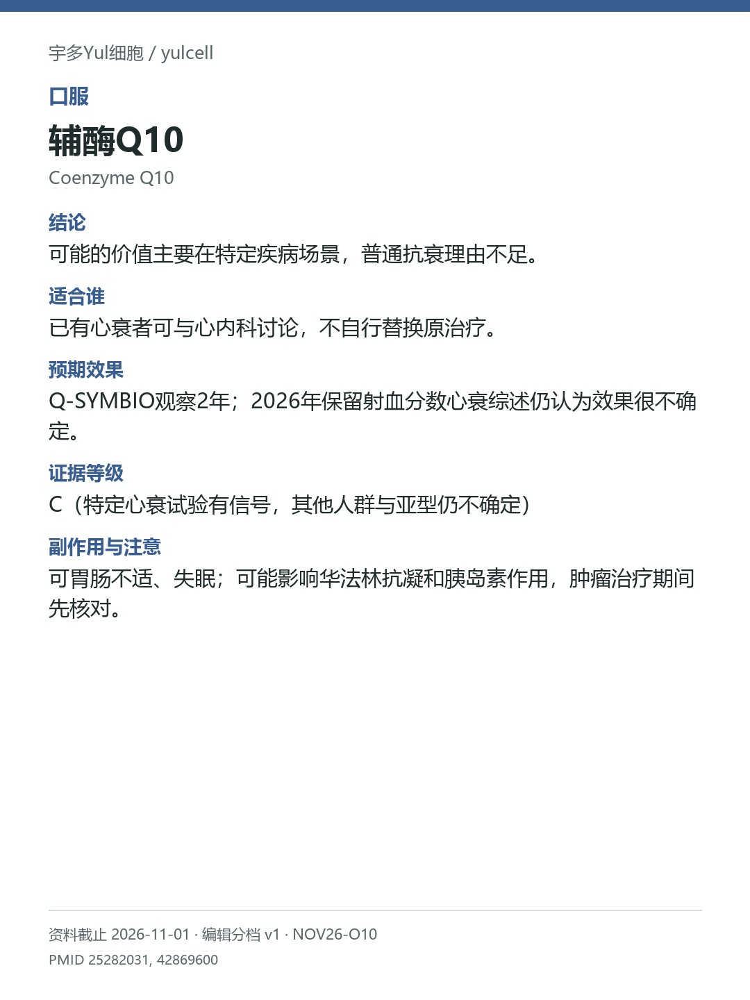

# 辅酶Q10 / Coenzyme Q10

途径：口服；用途：心衰事件、生活质量；资料截止：2026-11-01。

## 结论
可能的价值主要在特定疾病场景，普通抗衰理由不足。

## 适合谁
已有心衰者可与心内科讨论，不自行替换原治疗。

## 预期效果
Q-SYMBIO观察2年；2026年保留射血分数心衰综述仍认为效果很不确定。

## 证据等级
C（特定心衰试验有信号，其他人群与亚型仍不确定）

分档版本：ingredient-cards-editorial-v1；[规则](../../../methodology/ingredient-card-grading-v1.md)。

## 副作用与注意
可胃肠不适、失眠；可能影响华法林抗凝和胰岛素作用，肿瘤治疗期间先核对。

## 研究范围
口服CoQ10；不同心衰类型分开。人群：明确心衰等疾病场景；一般健康人不混入。不把一种心衰亚型的发现外推至所有人群。

## 来源
- [PMID 25282031](https://pubmed.ncbi.nlm.nih.gov/25282031/)
- [PMID 42869600](https://pubmed.ncbi.nlm.nih.gov/42869600/)

- [安全资料](https://www.nccih.nih.gov/health/coenzyme-q10)
