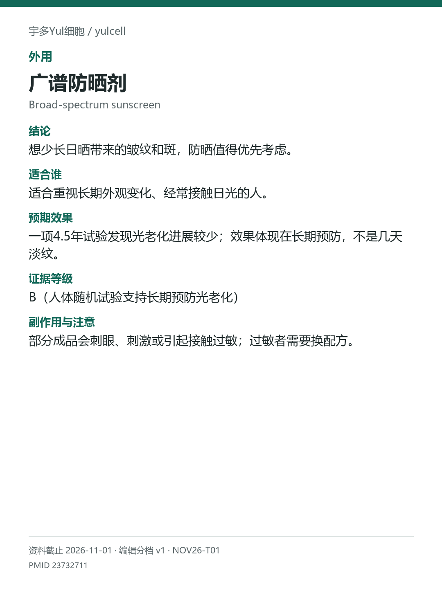

# 广谱防晒剂 / Broad-spectrum sunscreen

途径：外用；用途：光老化进展；资料截止：2026-11-01。

## 结论
想少长日晒带来的皱纹和斑，防晒值得优先考虑。

## 适合谁
适合重视长期外观变化、经常接触日光的人。

## 预期效果
一项4.5年试验发现光老化进展较少；效果体现在长期预防，不是几天淡纹。

## 证据等级
B（人体随机试验支持长期预防光老化）

分档版本：ingredient-cards-editorial-v1；[规则](../../../methodology/ingredient-card-grading-v1.md)。

## 副作用与注意
部分成品会刺眼、刺激或引起接触过敏；过敏者需要换配方。

## 研究范围
广谱防晒成品；不是某一种滤剂的单独排名。人群：有日晒暴露的成人。原试验日常使用与随意使用比较；不比较所有滤剂。

## 来源
- [PMID 23732711](https://pubmed.ncbi.nlm.nih.gov/23732711/)

