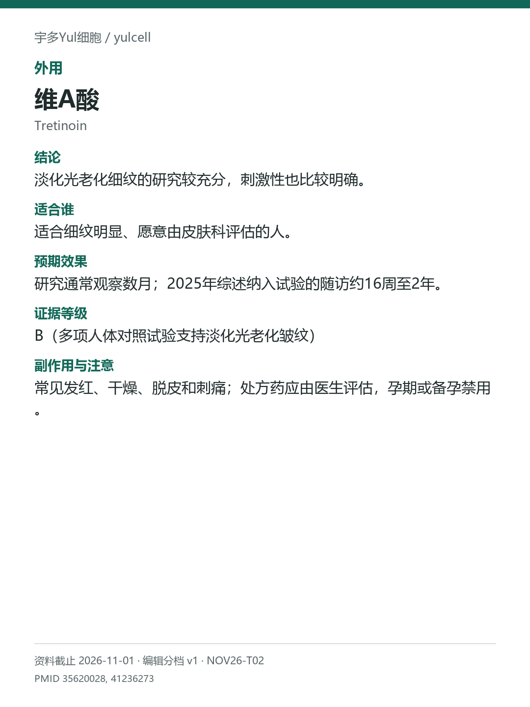

# 维A酸 / Tretinoin

途径：外用；用途：光老化皱纹；资料截止：2026-11-01。

## 结论
淡化光老化细纹的研究较充分，刺激性也比较明确。

## 适合谁
适合细纹明显、愿意由皮肤科评估的人。

## 预期效果
研究通常观察数月；2025年综述纳入试验的随访约16周至2年。

## 证据等级
B（多项人体对照试验支持淡化光老化皱纹）

分档版本：ingredient-cards-editorial-v1；[规则](../../../methodology/ingredient-card-grading-v1.md)。

## 副作用与注意
常见发红、干燥、脱皮和刺痛；处方药应由医生评估，孕期或备孕禁用。

## 研究范围
外用处方维A酸；与视黄醇分开。人群：有光老化细纹、肤质改变的成人。综述与其原试验不重复计数；未重做正式GRADE。

## 来源
- [PMID 35620028](https://pubmed.ncbi.nlm.nih.gov/35620028/)
- [PMID 41236273](https://pubmed.ncbi.nlm.nih.gov/41236273/)

- [安全资料](https://www.ema.europa.eu/en/news/updated-measures-pregnancy-prevention-during-retinoid-use)
