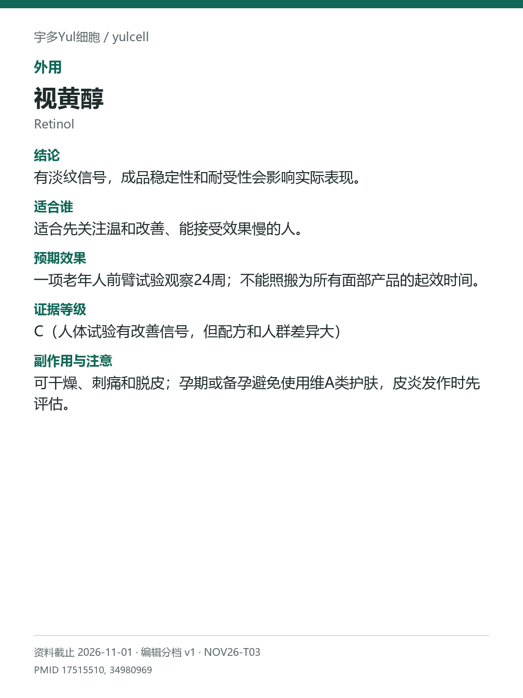

# 视黄醇 / Retinol

途径：外用；用途：细纹、肤质；资料截止：2026-11-01。

## 结论
有淡纹信号，成品稳定性和耐受性会影响实际表现。

## 适合谁
适合先关注温和改善、能接受效果慢的人。

## 预期效果
一项老年人前臂试验观察24周；不能照搬为所有面部产品的起效时间。

## 证据等级
C（人体试验有改善信号，但配方和人群差异大）

分档版本：ingredient-cards-editorial-v1；[规则](../../../methodology/ingredient-card-grading-v1.md)。

## 副作用与注意
可干燥、刺痛和脱皮；孕期或备孕避免使用维A类护肤，皮炎发作时先评估。

## 研究范围
外用视黄醇成品；效果依赖浓度和稳定性。人群：希望改善细纹的成人。不以维A酸的证据替视黄醇升级；不同酯类也不混算。

## 来源
- [PMID 17515510](https://pubmed.ncbi.nlm.nih.gov/17515510/)
- [PMID 34980969](https://pubmed.ncbi.nlm.nih.gov/34980969/)

- [安全资料](https://dermnetnz.org/topics/topical-retinoids)
