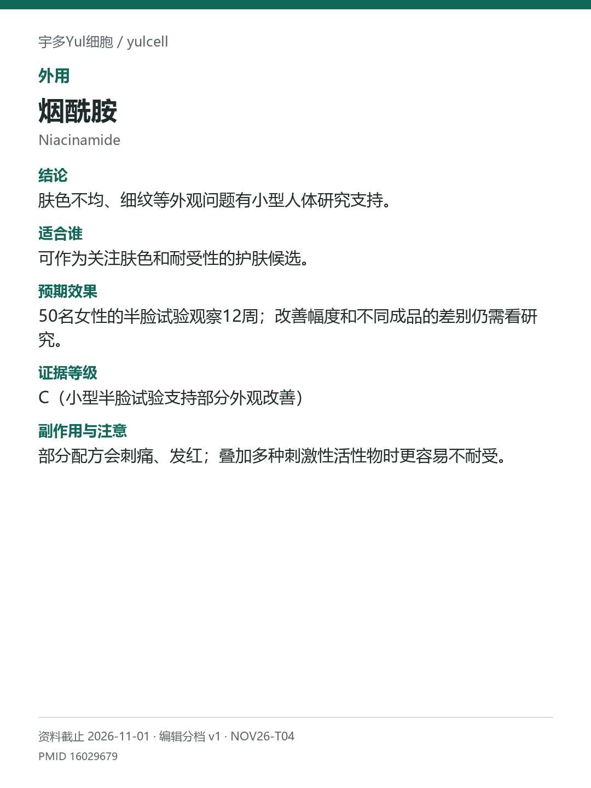

# 烟酰胺 / Niacinamide

途径：外用；用途：外观、色素与细纹；资料截止：2026-11-01。

## 结论
肤色不均、细纹等外观问题有小型人体研究支持。

## 适合谁
可作为关注肤色和耐受性的护肤候选。

## 预期效果
50名女性的半脸试验观察12周；改善幅度和不同成品的差别仍需看研究。

## 证据等级
C（小型半脸试验支持部分外观改善）

分档版本：ingredient-cards-editorial-v1；[规则](../../../methodology/ingredient-card-grading-v1.md)。

## 副作用与注意
部分配方会刺痛、发红；叠加多种刺激性活性物时更容易不耐受。

## 研究范围
外用烟酰胺乳霜。人群：有光老化外观或色素不均的成人。原研究为外用；作者有企业机构关联，不能并入口服安全与效果。

## 来源
- [PMID 16029679](https://pubmed.ncbi.nlm.nih.gov/16029679/)

