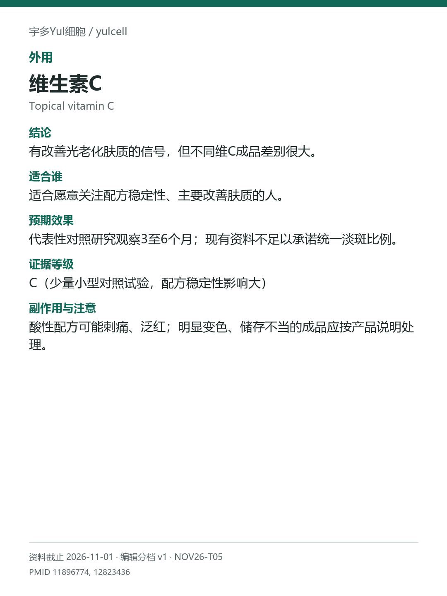

# 维生素C / Topical vitamin C

途径：外用；用途：肤质、细纹；资料截止：2026-11-01。

## 结论
有改善光老化肤质的信号，但不同维C成品差别很大。

## 适合谁
适合愿意关注配方稳定性、主要改善肤质的人。

## 预期效果
代表性对照研究观察3至6个月；现有资料不足以承诺统一淡斑比例。

## 证据等级
C（少量小型对照试验，配方稳定性影响大）

分档版本：ingredient-cards-editorial-v1；[规则](../../../methodology/ingredient-card-grading-v1.md)。

## 副作用与注意
酸性配方可能刺痛、泛红；明显变色、储存不当的成品应按产品说明处理。

## 研究范围
外用抗坏血酸配方；不同衍生物分别看证据。人群：有光老化外观改变的成人。不把抗氧化机制当临床疗效；不外推至口服维C。

## 来源
- [PMID 11896774](https://pubmed.ncbi.nlm.nih.gov/11896774/)
- [PMID 12823436](https://pubmed.ncbi.nlm.nih.gov/12823436/)

