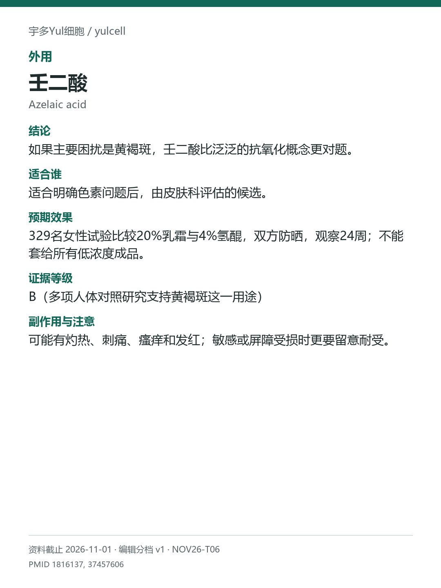

# 壬二酸 / Azelaic acid

途径：外用；用途：黄褐斑色素；资料截止：2026-11-01。

## 结论
如果主要困扰是黄褐斑，壬二酸比泛泛的抗氧化概念更对题。

## 适合谁
适合明确色素问题后，由皮肤科评估的候选。

## 预期效果
329名女性试验比较20%乳霜与4%氢醌，双方防晒，观察24周；不能套给所有低浓度成品。

## 证据等级
B（多项人体对照研究支持黄褐斑这一用途）

分档版本：ingredient-cards-editorial-v1；[规则](../../../methodology/ingredient-card-grading-v1.md)。

## 副作用与注意
可能有灼热、刺痛、瘙痒和发红；敏感或屏障受损时更要留意耐受。

## 研究范围
研究为20%壬二酸乳霜；浓度为研究条件。人群：黄褐斑相关人群。针对黄褐斑，不由色素改善推出皱纹或全身效果。浓度仅为试验描述，不是个人方案。

## 来源
- [PMID 1816137](https://pubmed.ncbi.nlm.nih.gov/1816137/)
- [PMID 37457606](https://pubmed.ncbi.nlm.nih.gov/37457606/)

