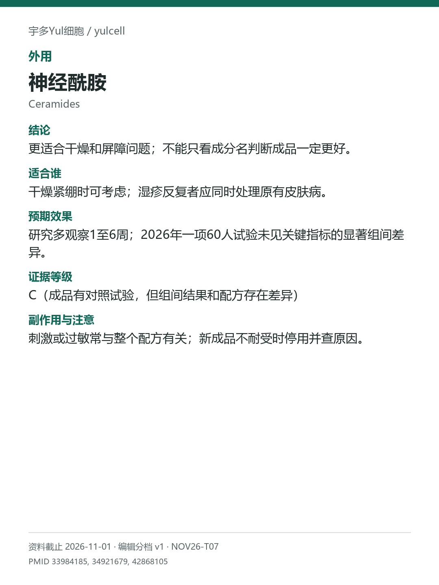

# 神经酰胺 / Ceramides

途径：外用；用途：保湿、屏障；资料截止：2026-11-01。

## 结论
更适合干燥和屏障问题；不能只看成分名判断成品一定更好。

## 适合谁
干燥紧绷时可考虑；湿疹反复者应同时处理原有皮肤病。

## 预期效果
研究多观察1至6周；2026年一项60人试验未见关键指标的显著组间差异。

## 证据等级
C（成品有对照试验，但组间结果和配方存在差异）

分档版本：ingredient-cards-editorial-v1；[规则](../../../methodology/ingredient-card-grading-v1.md)。

## 副作用与注意
刺激或过敏常与整个配方有关；新成品不耐受时停用并查原因。

## 研究范围
含神经酰胺的保湿配方；组合成品证据。人群：干燥或屏障受损、部分湿疹相关人群。2021年试验EASI组间阴性；只保留屏障/水分指标信号，不写湿疹疗效确定。

## 来源
- [PMID 33984185](https://pubmed.ncbi.nlm.nih.gov/33984185/)
- [PMID 34921679](https://pubmed.ncbi.nlm.nih.gov/34921679/)
- [PMID 42868105](https://pubmed.ncbi.nlm.nih.gov/42868105/)

