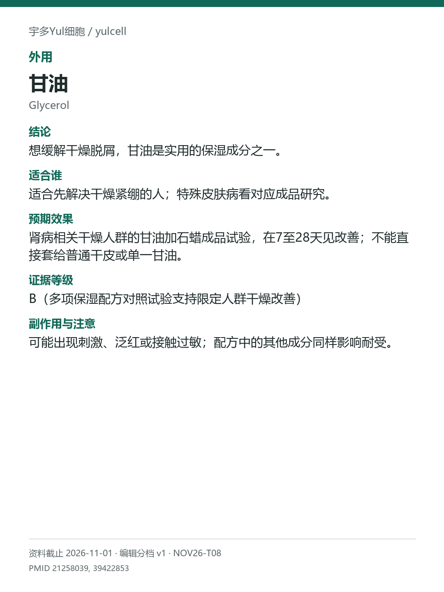

# 甘油 / Glycerol

途径：外用；用途：干燥、脱屑；资料截止：2026-11-01。

## 结论
想缓解干燥脱屑，甘油是实用的保湿成分之一。

## 适合谁
适合先解决干燥紧绷的人；特殊皮肤病看对应成品研究。

## 预期效果
肾病相关干燥人群的甘油加石蜡成品试验，在7至28天见改善；不能直接套给普通干皮或单一甘油。

## 证据等级
B（多项保湿配方对照试验支持限定人群干燥改善）

分档版本：ingredient-cards-editorial-v1；[规则](../../../methodology/ingredient-card-grading-v1.md)。

## 副作用与注意
可能出现刺激、泛红或接触过敏；配方中的其他成分同样影响耐受。

## 研究范围
含甘油的保湿配方；部分研究合用石蜡。人群：干燥、脱屑人群；主要试验为肾病相关干燥。主要试验含尿毒症皮肤干燥人群；不向所有干皮外推同一改善幅度。

## 来源
- [PMID 21258039](https://pubmed.ncbi.nlm.nih.gov/21258039/)
- [PMID 39422853](https://pubmed.ncbi.nlm.nih.gov/39422853/)

