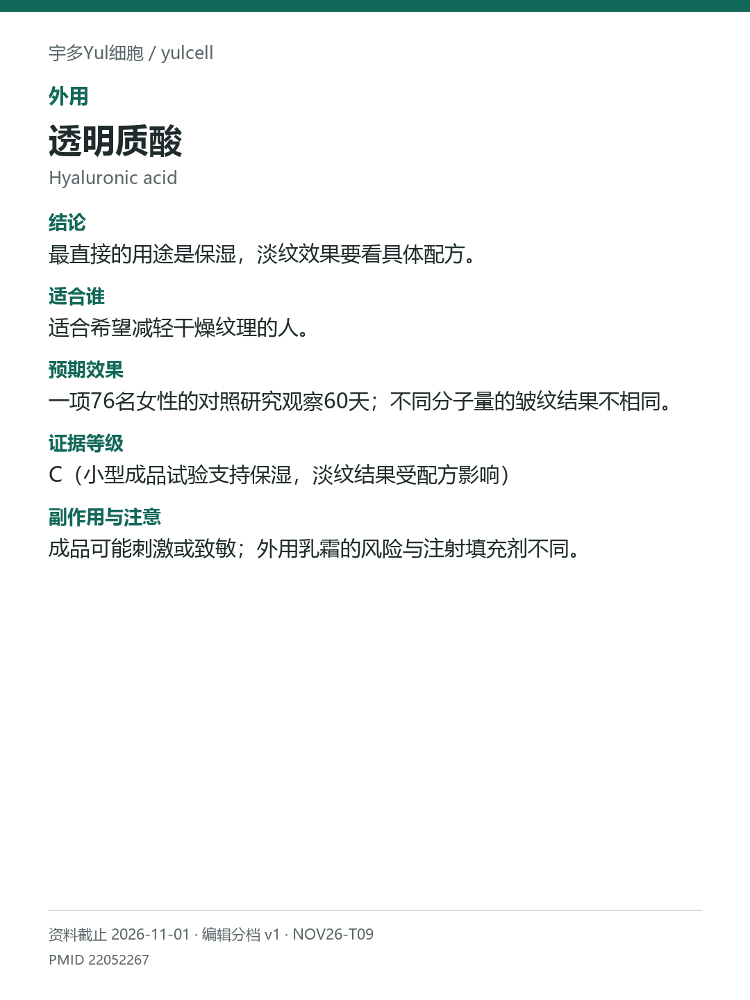

# 透明质酸 / Hyaluronic acid

途径：外用；用途：水分、细纹；资料截止：2026-11-01。

## 结论
最直接的用途是保湿，淡纹效果要看具体配方。

## 适合谁
适合希望减轻干燥纹理的人。

## 预期效果
一项76名女性的对照研究观察60天；不同分子量的皱纹结果不相同。

## 证据等级
C（小型成品试验支持保湿，淡纹结果受配方影响）

分档版本：ingredient-cards-editorial-v1；[规则](../../../methodology/ingredient-card-grading-v1.md)。

## 副作用与注意
成品可能刺激或致敏；外用乳霜的风险与注射填充剂不同。

## 研究范围
外用透明质酸乳霜；与填充注射分开。人群：干燥、眼周细纹相关人群。本次排除微针联合研究，不能把导入/注射证据算进普通外用。

## 来源
- [PMID 22052267](https://pubmed.ncbi.nlm.nih.gov/22052267/)

