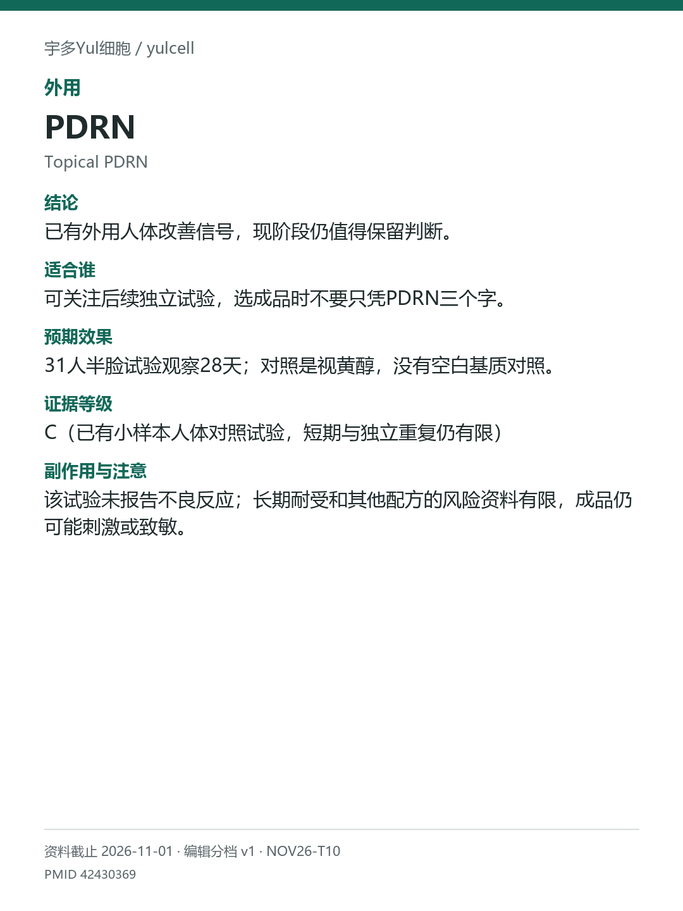

# PDRN / Topical PDRN

途径：外用；用途：眼周皱纹、弹性；资料截止：2026-11-01。

## 结论
已有外用人体改善信号，现阶段仍值得保留判断。

## 适合谁
可关注后续独立试验，选成品时不要只凭PDRN三个字。

## 预期效果
31人半脸试验观察28天；对照是视黄醇，没有空白基质对照。

## 证据等级
C（已有小样本人体对照试验，短期与独立重复仍有限）

分档版本：ingredient-cards-editorial-v1；[规则](../../../methodology/ingredient-card-grading-v1.md)。

## 副作用与注意
该试验未报告不良反应；长期耐受和其他配方的风险资料有限，成品仍可能刺激或致敏。

## 研究范围
特定PDRN-850K眼霜；不与PN或注射混算。人群：特定试验中的35至55岁敏感皮肤女性。全文核对，未完成独立正式RoB；无单一明确预设主要终点，企业任职作者与企业供料可见。

## 来源
- [PMID 42430369](https://pubmed.ncbi.nlm.nih.gov/42430369/)

