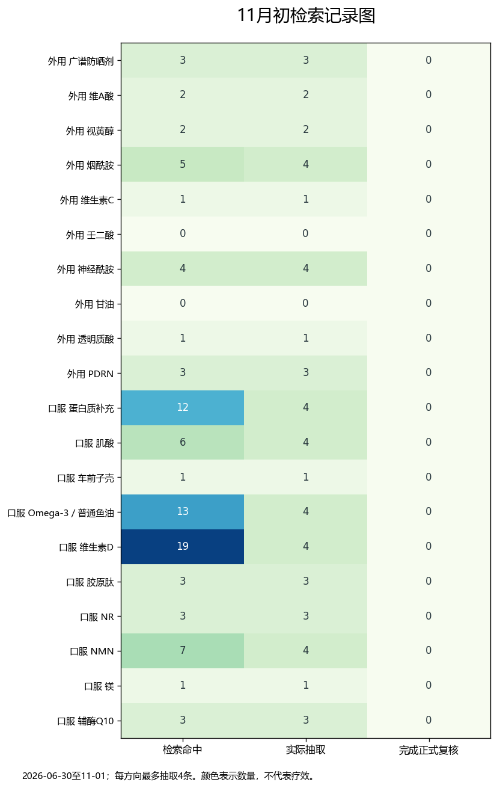

# 抗衰成分推荐｜按当前研究证据强度分级

外用10项，口服10项；按用途看成分与配方类别，不做跨终点总排名。

资料截止：2026-11-01；本次证据等级为 editorial-v1 编辑性概括。它与旧库自动 A–F 分档分开，未完成正式 GRADE，不将研究数量直接当作用强弱。

[证据等级规则](../../../methodology/ingredient-card-grading-v1.md) · [11月维护记录](../../../docs/november-maintenance-2026-11.md)

## 外用10项

| 成分 | 用途 | 证据等级 | 结论 |
| --- | --- | --- | --- |
| [广谱防晒剂](NOV26-T01.md) | 光老化进展 | B（人体随机试验支持长期预防光老化） | 想少长日晒带来的皱纹和斑，防晒值得优先考虑。 |
| [维A酸](NOV26-T02.md) | 光老化皱纹 | B（多项人体对照试验支持淡化光老化皱纹） | 淡化光老化细纹的研究较充分，刺激性也比较明确。 |
| [视黄醇](NOV26-T03.md) | 细纹、肤质 | C（人体试验有改善信号，但配方和人群差异大） | 有淡纹信号，成品稳定性和耐受性会影响实际表现。 |
| [烟酰胺](NOV26-T04.md) | 外观、色素与细纹 | C（小型半脸试验支持部分外观改善） | 肤色不均、细纹等外观问题有小型人体研究支持。 |
| [维生素C](NOV26-T05.md) | 肤质、细纹 | C（少量小型对照试验，配方稳定性影响大） | 有改善光老化肤质的信号，但不同维C成品差别很大。 |
| [壬二酸](NOV26-T06.md) | 黄褐斑色素 | B（多项人体对照研究支持黄褐斑这一用途） | 如果主要困扰是黄褐斑，壬二酸比泛泛的抗氧化概念更对题。 |
| [神经酰胺](NOV26-T07.md) | 保湿、屏障 | C（成品有对照试验，但组间结果和配方存在差异） | 更适合干燥和屏障问题；不能只看成分名判断成品一定更好。 |
| [甘油](NOV26-T08.md) | 干燥、脱屑 | B（多项保湿配方对照试验支持限定人群干燥改善） | 想缓解干燥脱屑，甘油是实用的保湿成分之一。 |
| [透明质酸](NOV26-T09.md) | 水分、细纹 | C（小型成品试验支持保湿，淡纹结果受配方影响） | 最直接的用途是保湿，淡纹效果要看具体配方。 |
| [PDRN](NOV26-T10.md) | 眼周皱纹、弹性 | C（已有小样本人体对照试验，短期与独立重复仍有限） | 已有外用人体改善信号，现阶段仍值得保留判断。 |

## 口服10项

| 成分 | 用途 | 证据等级 | 结论 |
| --- | --- | --- | --- |
| [蛋白质补充](NOV26-O01.md) | 肌肉与力量 | B（多项人体试验支持训练条件下的肌肉与力量获益） | 已经做力量训练、蛋白又吃不够时，补足蛋白更有实际意义。 |
| [肌酸](NOV26-O02.md) | 肌力、身体组成 | B（多项人体试验支持肌力小幅额外改善） | 配合力量训练，肌酸可能带来小幅额外力量收益。 |
| [车前子壳](NOV26-O03.md) | LDL胆固醇 | B（多项随机试验支持LDL小幅下降） | 它对降低LDL有比较直接的研究，比泛抗衰说法更具体。 |
| [Omega-3／普通鱼油](NOV26-O04.md) | 心血管事件、甘油三酯 | B（大型试验未支持普通人普遍补充预防主要心血管事件） | 普通鱼油不宜作为人人都该吃的心血管或抗衰必需品。 |
| [维生素D](NOV26-O05.md) | 骨骼、骨折 | B（大型随机试验未支持非缺乏人群常规补充防骨折） | 先判断是否缺乏或有骨骼方面的需要，再谈补充价值。 |
| [胶原肽](NOV26-O06.md) | 皮肤水分、弹性、皱纹 | C（总体结果与高质量、非企业资助亚组存在分歧） | 有改善皮肤外观的研究，但把握低于宣传给人的感觉。 |
| [NR](NOV26-O07.md) | NAD代谢物、认知与疾病功能 | C（能升高NAD，但功能与疾病结局未见一致改善） | 升高NAD比较容易看到，健康和功能获益仍不稳定。 |
| [NMN](NOV26-O08.md) | 代谢指标、身体功能 | C（人体研究可升高NAD，临床与功能获益仍有限） | 已有小型人体研究，尚不足以把它列为普遍值得买的抗衰补剂。 |
| [镁](NOV26-O09.md) | 睡眠 | C（睡眠试验数量少，偏倚和结果不一致） | 补镁帮助睡眠的证据有限，不能把复合产品结果归给镁。 |
| [辅酶Q10](NOV26-O10.md) | 心衰事件、生活质量 | C（特定心衰试验有信号，其他人群与亚型仍不确定） | 可能的价值主要在特定疾病场景，普通抗衰理由不足。 |

## 研究记录图

每方向最多抽取4条最新记录；全部命中数和抽取数量分别保留。颜色表示检索与审核数量，不是成分效果排名。
