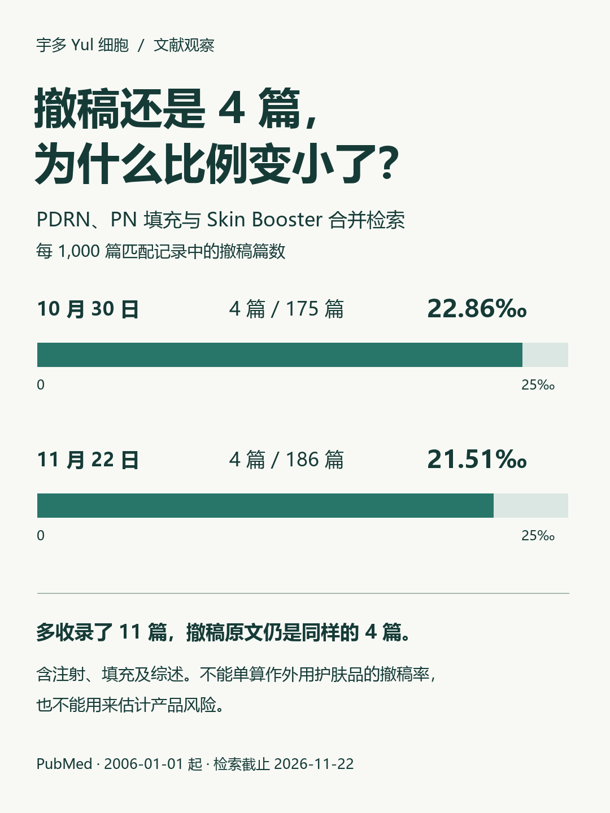

# 11 月文献更新：胶原、鱼油和撤稿的分母

**截至 2026-11-22。** 本期增加了 22 条候选来源，成分卡没有升降级。候选表示有理由接着读，不表示研究已经证明有效。

## 这三件事值得看

**喝胶原，皮肤更湿润就等于皱纹变浅吗？** 一篇综述合并了 35 项随机试验：仪器测出的水分和弹性有改善，肉眼关心的皱纹结果不稳。另一组研究者复算已有综述，发现部分测量不宜放在一起，自己的分析未见明确获益。还有一项 140 人、12 周的试验，喝的是胶原、维生素 E 和谷胱甘肽的组合；部分弹性和鱼尾纹粗糙度有差异，保湿却没有组间差异。这三篇都在 11 月被 PubMed 收录，最早一篇 7 月已在线发表。口服胶原肽卡保留 C。[综述](https://pubmed.ncbi.nlm.nih.gov/43047141/) · [复算](https://pubmed.ncbi.nlm.nih.gov/43047302/) · [复方试验](https://pubmed.ncbi.nlm.nih.gov/43047132/)

**新出的鱼油论文，有没有新招一批人？** 11 月的文章回顾同一个 VITAL 试验及其子研究。一般人群中，主要结果（心梗、卒中或心血管死亡合在一起）未见明确下降；部分单项结果有差异。不能把这篇综述再算成一批新受试者，普通鱼油卡保留 B：这个 B 是对结论的把握，不是购买建议。[11 月综述](https://pubmed.ncbi.nlm.nih.gov/43033966/) · [原试验](https://pubmed.ncbi.nlm.nih.gov/30415637/)

**生活方式没拨慢“年龄时钟”，说明运动没用吗？** 一篇综述找到 9 项随机试验，其中 8 项、1,675 人可以合并。三类时钟都没测到明确变化，作者对结果的把握较低。这些研究测的是 DNA 上的化学标记，不是走路能力、心梗或能活多久。问哪一种好处，就要找测了那件事的研究。[研究摘要](https://pubmed.ncbi.nlm.nih.gov/43038634/)

## 为什么撤稿比例变小了

按原来 117 组题名和语境检索，从 2006-01-01 查到 11-22。同一原文可能被多个主题找到：616 条主题匹配，去重是 **559 篇**，上次是 546 篇。多出的 13 篇均已核对原文的撤稿标签和关联通知，均不在本期 11,279 条来源目录内。9 份通知的在线发表日期在 11 月，3 份在 10 月，1 份没有给出在线日期。故不能写成“本月撤稿 13 篇”。[13 组原文与通知](../data/maintenance_2026_11_22/new-retraction-matches.csv)

图里 4 篇包括填充或注射研究及宽泛的综述，不能归到同一个外用护肤配方。PubMed 还提示，一个带引号的填充词组未建短语索引；其他同义词保留，分子和分母沿用同一检索式。[117 个分子、分母](../data/maintenance_2026_11_22/retraction-density.csv) · [完整检索式与提示](../data/maintenance_2026_11_22/retraction-queries.json)

## 去哪里查文献

- [本期新增 22 条：中文短标题、英文题名和来源](../data/maintenance_2026_11_22/new-candidates.csv)
- [下载完整来源目录，11,279 条 CSV](https://raw.githubusercontent.com/yuyohe/longevity-antiaging-evidence-atlas-EnCn/main/data/maintenance_2026_11_22/literature-library.csv)，其中 11,158 个不同的 PMID。目录还包括试验注册等其他来源。
- [检索到的 502 个 PMID](../data/maintenance_2026_11_22/retrieval.csv) · [逐项编辑取舍](../data/maintenance_2026_11_22/editorial.tsv) · [59 组检索记录](../data/maintenance_2026_11_22/search.json)
- [正式入选快照：2,497 条优先复核、1,500 条矩阵](full-library.md) · [20 张成分卡与评级规则](../content/cards/ingredients-2026-11/index.md)

## 复核范围

成分的 20 组检索与 1 组撤稿提醒覆盖 11-02 至 11-22；常规主题从上次正式快照次日（10-31）补查。检索同时考虑发表日期与 PubMed 入库日期。38 个常规主题沿用每组 12 至 20 条的抽取上限，其中 27 组达到截断；20 组成分检索取回全部 24 条匹配，跨成分去重为 23 篇。502 是三部分实际取回后去重的数，不是期间论文总量。

23 篇成分匹配逐条作了取舍。另择常规主题的临床结局、日常功能或时钟研究，以及需标记的期刊通知；未选条目留在检索表，未做全文排除。最终 24 条候选中 2 条在旧库，未重复添加。此次做题录与摘要复核，没有新增正式全文偏倚评估，也没有改写 10 月的证据矩阵。

另查了上批 83 个 PMID 的更正、撤稿与关注标记，未发现这些标记变化；4 项注册记录及 3 个 DOI 的指定字段无变化。常规检索另识别出[一份期刊关注声明](https://pubmed.ncbi.nlm.nih.gov/42725387/)、[一份动物研究更正](https://pubmed.ncbi.nlm.nih.gov/42965647/)和[听力试验的摘要更正](https://pubmed.ncbi.nlm.nih.gov/43002407/)。均单独关联，不当作新试验或新撤稿。[复核记录](../data/maintenance_2026_11_22/source-checks.json)

**English:** Late-November surveillance added 22 candidate sources (11,279 total), with no formal evidence promotions or changes to the ingredient grades. The PDRN/PN/skin-booster search matched the same four retracted publications among 186 titles, up from 175 titles. This mixed-route bibliographic measure is not a product safety estimate.
